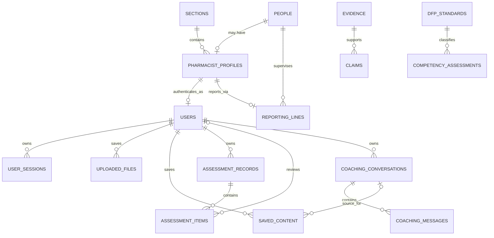

# PharmPath database schema

## Overview

The local system of record is SQLite at `data/pharmfolio.db`. SQLAlchemy declarations in `db/models.py` own schema creation, and `python -m scripts.seed_database` performs an idempotent import from `pharmacist_profile.csv`.

The source CSV requires these columns:

1. `Pharmacist Name`
2. `Pharmacist Job Grade`
3. `Career Track`
4. `RO`
5. `Section`

It may also provide `team_view`, the retained compatibility-only `division_view`, and `Years in current job grade`. Missing tenure remains `NULL` and is never inferred.

The import normalizes repeated section and person names. Sarah is both a pharmacist profile and a reporting officer, so she receives one shared person identity, one pharmacist profile, and one user account. `reporting_lines` expresses manager relationships without duplicating names. Application accounts are one-to-one with pharmacist profiles.

Uploaded bytes are deliberately excluded from SQLite. `uploaded_files` stores ownership, validation metadata, a content digest, and a safe server-side storage reference. Existing evidence-analysis workflow tables remain intact for compatibility with local evidence analysis.

## Entity relationship diagram



## Source-directory and authentication tables

### `sections`

| Column | Type | Constraints | Purpose |
|---|---|---|---|
| `id` | INTEGER | Primary key, auto-increment | Section identifier. |
| `name` | VARCHAR(200) NOCASE | Required, unique | Exact section name from the CSV. |
| `created_at` | DATETIME | Required, default current timestamp | Creation audit timestamp. |

### `people`

| Column | Type | Constraints | Purpose |
|---|---|---|---|
| `id` | INTEGER | Primary key, auto-increment | Person identifier. |
| `full_name` | VARCHAR(200) NOCASE | Required, unique | Trimmed pharmacist or reporting-officer name. |
| `created_at` | DATETIME | Required, default current timestamp | Creation audit timestamp. |

### `pharmacist_profiles`

| Column | Type | Constraints | Purpose |
|---|---|---|---|
| `person_id` | INTEGER | Primary key; FK `people.id`, cascade delete | The pharmacist's person identity. |
| `job_grade` | VARCHAR(3) | Required; check `P` plus two digits | CSV job grade. |
| `career_track` | VARCHAR(100) | Required | CSV career track. |
| `years_in_grade` | FLOAT | Optional | CSV tenure; `NULL` when the source does not provide it. |
| `section_id` | INTEGER | Required; FK `sections.id`, restrict delete; indexed | Organisational section. |
| `source_row_number` | INTEGER | Required, unique, greater than 1 | Traceability to the CSV row. |
| `created_at` | DATETIME | Required, default current timestamp | Creation audit timestamp. |
| `updated_at` | DATETIME | Required, updated on change | Last synchronized timestamp. |

### `reporting_lines`

| Column | Type | Constraints | Purpose |
|---|---|---|---|
| `pharmacist_person_id` | INTEGER | Primary key; FK `pharmacist_profiles.person_id`, cascade delete | Direct report. One current reporting line per profile. |
| `supervisor_person_id` | INTEGER | Required; FK `people.id`, restrict delete; indexed | Reporting officer, including external directory-only people. |
| `created_at` | DATETIME | Required, default current timestamp | Creation audit timestamp. |

The table checks that a pharmacist cannot report to themselves.

### `users`

| Column | Type | Constraints | Purpose |
|---|---|---|---|
| `id` | VARCHAR(36) | Primary key | Opaque application user ID. |
| `profile_id` | INTEGER | Required, unique; FK `pharmacist_profiles.person_id`, restrict delete; indexed | One-to-one pharmacist profile. |
| `username` | VARCHAR(80) NOCASE | Required, unique; length 3–80 | Case-insensitive login name. |
| `password_hash` | VARCHAR(255) | Required | Salted PBKDF2-SHA256 verifier; never plaintext. |
| `role` | VARCHAR(30) | Required; existing enum retained for database compatibility | Server-side role. |
| `team_view` | BOOLEAN | Required, default false | Team Dashboard authorization. |
| `division_view` | BOOLEAN | Required, default false | Retained compatibility field; the Division surface has been removed. |
| `is_active` | BOOLEAN | Required, default true | Account revocation switch. |
| `created_at` | DATETIME | Required, default current timestamp | Creation timestamp. |
| `updated_at` | DATETIME | Required, updated on change | Last account update. |

### `user_sessions`

| Column | Type | Constraints | Purpose |
|---|---|---|---|
| `token_hash` | VARCHAR(64) | Primary key | SHA-256 digest of the opaque browser token. |
| `user_id` | VARCHAR(36) | Required; FK `users.id`, cascade delete; indexed | Session owner. |
| `expires_at` | DATETIME | Required, indexed | Absolute expiry. |
| `created_at` | DATETIME | Required, default current timestamp | Session creation. |
| `last_seen_at` | DATETIME | Required, default current timestamp | Last authenticated use. |

## User-owned saved-content tables

### `assessment_records` and `assessment_items`

`assessment_records` owns one workflow assessment cycle for one user and preserves the immutable structured AI result in `ai_result_json`. Its status is `draft` or `submitted`.

`assessment_items` keeps the pharmacist's confidence/justification and the direct reporting officer's authoritative confidence/justification in separate nullable columns. Each item is unique within its assessment by `item_key`; confidence columns are constrained to 0–1. Reads apply reporting-officer final, then submitted pharmacist value, then AI value. Direct-report authorization is always checked through `reporting_lines` before officer reads or writes.

### `uploaded_files`

| Column | Type | Constraints | Purpose |
|---|---|---|---|
| `id` | VARCHAR(36) | Primary key | Upload metadata ID. |
| `user_id` | VARCHAR(36) | Required; FK `users.id`, cascade delete; indexed | Owner; every read/download filters on this value. |
| `context` | VARCHAR(30) | Required; allowed tab context; indexed | Evidence, assessment, coaching, or development plan. |
| `original_filename` | VARCHAR(500) | Required | Sanitized base filename for display/download. |
| `mime_type` | VARCHAR(150) | Required | Submitted or inferred MIME type. |
| `size_bytes` | INTEGER | Required, non-negative | Validated content size. |
| `storage_path` | VARCHAR(1200) | Required, unique | Opaque server-side file reference; not sent by listing APIs. |
| `sha256` | VARCHAR(64) | Required | Content-integrity digest. |
| `uploaded_at` | DATETIME | Required, default current timestamp; indexed | Upload timestamp. |

### `saved_content`

| Column | Type | Constraints | Purpose |
|---|---|---|---|
| `id` | VARCHAR(36) | Primary key | Saved item ID. |
| `user_id` | VARCHAR(36) | Required; FK `users.id`, cascade delete; indexed | Owner. |
| `context` | VARCHAR(30) | Required; assessment/coaching/development plan; indexed | Source tab. |
| `content_type` | VARCHAR(40) | Required; constrained to supported types | Assessment snapshot, coaching summary, or development plan. |
| `title` | VARCHAR(250) | Required | Human-readable saved-item title. |
| `body` | TEXT | Required | Generated snapshot or summary payload. |
| `is_ai_generated` | BOOLEAN | Required, default true | Explicit provenance label. |
| `source_conversation_id` | VARCHAR(36) | Optional FK `coaching_conversations.id`, set null on delete; indexed | Coaching-summary source. |
| `metadata_json` | JSON | Required | Useful context such as selected profile or summary-message ID. |
| `created_at` | DATETIME | Required, default current timestamp; indexed | Save timestamp. |
| `updated_at` | DATETIME | Required, updated on change | Last update timestamp. |

### `coaching_conversations`

| Column | Type | Constraints | Purpose |
|---|---|---|---|
| `id` | VARCHAR(36) | Primary key | Conversation ID. |
| `user_id` | VARCHAR(36) | Required; FK `users.id`, cascade delete; indexed | Owner. |
| `title` | VARCHAR(200) | Required | Initially generic; updated from the first user message. |
| `created_at` | DATETIME | Required, default current timestamp | Creation time. |
| `updated_at` | DATETIME | Required, updated on new messages; indexed | Recency sorting. |

### `coaching_messages`

| Column | Type | Constraints | Purpose |
|---|---|---|---|
| `id` | VARCHAR(36) | Primary key | Message ID. |
| `conversation_id` | VARCHAR(36) | Required; FK `coaching_conversations.id`, cascade delete; indexed | Parent conversation. |
| `author_role` | VARCHAR(20) | Required; user or assistant | Authorship. |
| `message_type` | VARCHAR(20) | Required; chat or summary | Distinguishes conversational replies from generated summaries. |
| `content` | TEXT | Required | Message or concise summary text. |
| `is_ai_generated` | BOOLEAN | Required, default false | Provenance label. |
| `metadata_json` | JSON | Required | Summary action items or future non-sensitive metadata. |
| `created_at` | DATETIME | Required, default current timestamp; indexed | Message order/audit timestamp. |

## Existing evidence-workflow tables

These tables predate app authentication and remain the canonical local evidence-analysis records. Their `tenant_id` and `user_id` values are server-derived from the authenticated actor. They intentionally retain string ownership columns instead of new foreign keys so existing workflow records remain compatible.

### `evidence`

| Column | Type | Constraints | Purpose |
|---|---|---|---|
| `id` | VARCHAR(36) | Primary key | Workflow evidence ID. |
| `filename` | VARCHAR(500) | Required | Source filename. |
| `storage_uri` | VARCHAR(1200) | Required | Server-side source reference. |
| `media_type` | VARCHAR(100) | Required | Media type. |
| `summary` | TEXT | Required | Bounded graph-safe summary. |
| `created_at` | DATETIME | Required, default current timestamp | Creation time. |
| `tenant_id` | VARCHAR(100) | Required, indexed | Tenant boundary. |
| `user_id` | VARCHAR(100) | Required, indexed | Authenticated owner ID. |

### `claims`

| Column | Type | Constraints | Purpose |
|---|---|---|---|
| `id` | VARCHAR(36) | Primary key | Extracted claim ID. |
| `evidence_id` | VARCHAR(36) | Required; FK `evidence.id`; indexed | Provenance source. |
| `statement` | TEXT | Required | Evidence-supported claim. |
| `excerpt` | TEXT | Required | Short source excerpt. |
| `activity_title` | VARCHAR(500) | Required | Associated activity. |
| `metadata_json` | JSON | Required | Dates, setting, role, stakeholders, outcomes. |
| `tenant_id` | VARCHAR(100) | Required, indexed | Tenant boundary. |
| `user_id` | VARCHAR(100) | Required, indexed | Owner. |

### `competency_assessments`

| Column | Type | Constraints | Purpose |
|---|---|---|---|
| `id` | VARCHAR(36) | Primary key | Provisional assessment ID. |
| `workflow_id` | VARCHAR(100) | Required, indexed | Workflow correlation ID. |
| `standard_id` | VARCHAR(20) | Required, indexed | Controlled DFP standard ID. |
| `proposed_level` | VARCHAR(40) | Required | AI-proposed evidence level. |
| `confidence_score` | FLOAT | Required | Numeric model confidence. |
| `status` | VARCHAR(40) | Required | Provisional/review status. |
| `rationale` | TEXT | Required | Evidence-grounded explanation. |
| `provenance_json` | JSON | Required | Evidence ID/reference/excerpt. |
| `sensitivity_flags` | JSON | Required | Review-gate flags. |
| `tenant_id` | VARCHAR(100) | Required, indexed | Tenant boundary. |
| `user_id` | VARCHAR(100) | Required, indexed | Owner. |

### `development_plans`

| Column | Type | Constraints | Purpose |
|---|---|---|---|
| `id` | VARCHAR(36) | Primary key | Confirmed workflow plan ID. |
| `workflow_id` | VARCHAR(100) | Required, indexed | Source workflow. |
| `status` | VARCHAR(30) | Required | Confirmation status. |
| `actions_json` | JSON | Required | Explicitly accepted actions. |
| `confirmed_at` | DATETIME | Required | Confirmation timestamp. |
| `tenant_id` | VARCHAR(100) | Required, indexed | Tenant boundary. |
| `user_id` | VARCHAR(100) | Required, indexed | Owner. |

### `dfp_standards`

| Column | Type | Constraints | Purpose |
|---|---|---|---|
| `id` | VARCHAR(20) | Primary key | Controlled standard number. |
| `domain` | VARCHAR(200) | Required | DFP domain. |
| `name` | VARCHAR(500) | Required | Standard name. |
| `training_tracks_json` | JSON | Required | Optional applicable tracks. |

### `audit_records`

| Column | Type | Constraints | Purpose |
|---|---|---|---|
| `id` | VARCHAR(36) | Primary key | Append-only event ID. |
| `event_type` | VARCHAR(100) | Required, indexed | Workflow event type. |
| `workflow_id` | VARCHAR(100) | Required, indexed | Correlation ID. |
| `details_json` | JSON | Required | Event details. |
| `created_at` | DATETIME | Required, default current timestamp | Event time. |
| `tenant_id` | VARCHAR(100) | Required, indexed | Tenant boundary. |
| `user_id` | VARCHAR(100) | Required, indexed | Actor/owner. |

### `dashboard_metrics`

| Column | Type | Constraints | Purpose |
|---|---|---|---|
| `id` | VARCHAR(36) | Primary key | Projection ID. |
| `workflow_id` | VARCHAR(100) | Required, indexed | Source workflow. |
| `metric_json` | JSON | Required | Persisted workflow counts/status only. |
| `updated_at` | DATETIME | Required | Last projection update. |
| `tenant_id` | VARCHAR(100) | Required, indexed | Tenant boundary. |
| `user_id` | VARCHAR(100) | Required, indexed | Profile account owner. |

The composite unique constraint on `(tenant_id, user_id, workflow_id)` prevents duplicate dashboard projections.

## Recreate, seed, and inspect

Create or safely synchronize the schema and CSV data:

```powershell
.\.venv\Scripts\Activate.ps1
python -m scripts.seed_database
```

For a clean local rebuild, stop the app, move `data/pharmfolio.db` to a backup location, and run the seed command. Do not delete a production database to apply source changes; the import is idempotent and updates source-owned profile fields in place.

Inspect with Python's built-in SQLite driver:

```powershell
python -c "import sqlite3; db=sqlite3.connect('data/pharmfolio.db'); print(*db.execute('SELECT name FROM sqlite_master WHERE type=\"table\" ORDER BY name'), sep='\n')"
python -c "import sqlite3; db=sqlite3.connect('data/pharmfolio.db'); print(*db.execute('SELECT u.username,p.full_name,u.role,u.team_view,u.division_view FROM users u JOIN people p ON p.id=u.profile_id ORDER BY u.username'), sep='\n')"
```

Helpful queries:

```sql
-- Pharmacist directory with reporting officer and section
SELECT p.full_name, pp.job_grade, pp.career_track, s.name AS section,
       ro.full_name AS reporting_officer
FROM pharmacist_profiles pp
JOIN people p ON p.id = pp.person_id
JOIN sections s ON s.id = pp.section_id
LEFT JOIN reporting_lines rl ON rl.pharmacist_person_id = pp.person_id
LEFT JOIN people ro ON ro.id = rl.supervisor_person_id
ORDER BY p.full_name;

-- One user's explicitly saved items
SELECT context, content_type, title, is_ai_generated, created_at
FROM saved_content
WHERE user_id = ?
ORDER BY created_at DESC;

-- Verify that only metadata, not upload bytes, is in SQLite
SELECT original_filename, mime_type, size_bytes, uploaded_at
FROM uploaded_files
WHERE user_id = ? AND context = 'evidence';
```

Run `PRAGMA foreign_key_check;` after a manual data migration and `PRAGMA optimize;` after significant imports.

## Demonstration credentials and permissions

| Username | Password | `role` | `team_view` | `division_view` |
|---|---|---|---:|---:|
| `alex` | `PharmPath-Alex!` | `pharmacist` | 0 | 0 |
| `jane` | `PharmPath-Jane!` | `pharmacist` | 0 | 0 |
| `ben` | `PharmPath-Ben!` | `pharmacist` | 0 | 0 |
| `jack` | `PharmPath-Jack!` | `pharmacist` | 0 | 0 |
| `alice` | `PharmPath-Alice!` | `pharmacist` | 0 | 0 |
| `jamie` | `PharmPath-Jamie!` | `pharmacist` | 0 | 0 |
| `benedict` | `PharmPath-Benedict!` | `pharmacist` | 0 | 0 |
| `jeremy` | `PharmPath-Jeremy!` | `pharmacist` | 0 | 0 |
| `betty` | `PharmPath-Betty!` | `team_lead` | 1 | 0 |
| `tommy` | `PharmPath-Tommy!` | `division_lead` | 1 | 1 |

These passwords are deliberately memorable demonstration credentials, not production secrets. Change the provisioning method and rotate all credentials before real use.
